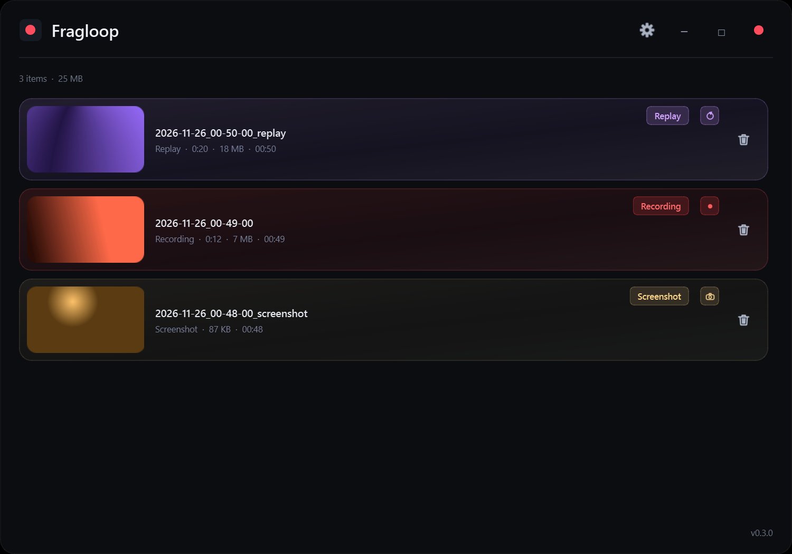

# Fragloop

GPU-direct game clip recorder for Windows, with a replay buffer you can set
from 1 to 15 minutes.



Fragloop records your display at a constant 120 fps straight from the GPU and
keeps a rolling buffer (5 minutes by default, up to 15). Press `Alt+P` and the
buffer is saved as an MP4 — no need to have been recording. `Alt+G` records
manually, and `Alt+F` saves a PNG screenshot.

## Download

Prebuilt Windows builds are on the [Releases](https://github.com/shaankatoch304/Fragloop/releases) page.

- **Setup (recommended)** — `Fragloop-0.3.0-win64-setup.exe`: per-user install,
  Start menu shortcut, optional autostart.
- **Portable** — `Fragloop-0.3.0-win64-portable.zip`: extract anywhere and run
  `Fragloop.exe`.
- **Checksums** — `SHA256SUMS.txt` lists the hashes of both builds.

The builds are unsigned, so SmartScreen may show "Windows protected your PC".
Choose **More info → Run anyway**.

## Features

- **Direct GPU pipeline** — Desktop Duplication (`ddagrab`) feeds `hevc_nvenc`
  without a CPU frame copy, so fast games stay smooth.
- **Constant 120 fps** — CFR output avoids the judder VFR capture produces in
  players, even on a 240 Hz panel.
- **Configurable replay buffer** — 1 to 15 minutes with second-level precision
  (5 minutes by default), two-second segments, saved in seconds.
- **System audio and optional mic** — WASAPI loopback switches automatically
  when you change the Windows default output device. Pick a microphone in
  Preferences to mix it into every replay and recording; system audio is
  always included.
- **Screenshots** — `Alt+F` saves a PNG of the display to `Videos\Captures`.
- **Themed clip cards** — screenshots get a warm card with a camera badge,
  replay saves a violet card with a replay arrow, and manual recordings a red
  card with a record dot; each row names its type beside the badge.
- **Instant save feedback** — a replay save or a recording stop appears in the
  library immediately as a "Saving…" row, then becomes the finished clip.
- **Native window and tray** — a frameless, translucent clip library with
  thumbnails, clip count and total size, a preferences window for appearance,
  recording, clips and storage, and hotkeys that work while a game has focus.
- **MP4 (10-bit HEVC + AAC)** — roughly half the H.264 size at the same
  quality. Windows needs the free HEVC Video Extension (or VLC/MPC) to play it.

## Requirements

- Windows 10/11, 64-bit
- NVIDIA GPU with NVENC (Turing or newer recommended)
- Release builds include ffmpeg. Source builds need ffmpeg 7 or newer
  (`ffmpeg.exe` and `ffprobe.exe`) next to `Fragloop.exe`
- Free disk space: the replay buffer uses up to ~4 GB at the default five
  minutes (~9 GB at 15 minutes), a saved five-minute replay is ~2.3 GB typical
  (~3.4 GB at the cap), and a seven-minute manual clip stays under 5 GB. Saving
  needs room for the temporary concat as well (~2x briefly).

Tested on Windows 11, RTX 5070 Ti Laptop GPU, 2560x1600 @ 240 Hz.

## Hotkeys

| Shortcut | Action |
| --- | --- |
| `Alt+G` / `Ctrl+Alt+G` | Start / stop a manual recording |
| `Alt+P` / `Ctrl+Alt+P` | Save the replay buffer (last 1–15 minutes) |
| `Alt+F` / `Ctrl+Alt+F` | Save a PNG screenshot |

Clips are written to `Videos\Captures`. Settings live at the top of
`recorder.py` (`RECORD_FPS`, `VIDEO_BITRATE`, `VIDEO_MAXRATE`, `SEGMENT_SECONDS`).
The replay length is set in Preferences (1–15 minutes, second-level precision).

## How it works

1. `ddagrab` captures the display on the GPU and duplicates frames to a
   constant 120 fps.
2. `hevc_nvenc` encodes 10-bit HEVC at an 80 Mbit/s average (110 Mbit/s peaks) into two-second Matroska
   segments tagged with forced IDR frames, so the replay buffer can be
   concatenated without re-encoding.
3. WASAPI loopback writes 48 kHz stereo PCM into rotating five-minute chunks,
   padded against the wall clock so silence does not shift the timeline.
4. A replay save concatenates the newest segments for the chosen length, trims
   the matching audio tail, and remuxes video (copy) plus AAC audio into an MP4.
5. The engine runs as a tray process; `Fragloop.exe` opens the window and starts
   the engine as a child process, so a window crash cannot stop a recording.

## Build from source

```powershell
python -m venv .venv
.venv\Scripts\activate
pip install -r requirements.txt
pip install -r requirements-dev.txt

# Put ffmpeg.exe and ffprobe.exe in the project root first.
python -m PyInstaller --noconfirm Fragloop.spec
Copy-Item ffmpeg.exe,ffprobe.exe dist\Fragloop\
```

The build lands in `dist\Fragloop`. Run it from there; the app expects
`ffmpeg.exe` and `ffprobe.exe` beside the executable.

Build the installer and portable zip (needs Inno Setup 6):

```powershell
powershell -ExecutionPolicy Bypass -File scripts\build_release.ps1
```

Both release files are written to `release\`.

Run from source instead:

```powershell
pythonw app.py        # window + engine
python recorder.py    # engine only (tray, hotkeys, capture)
```

Development checks:

- `python selftest.py` — record four seconds and verify video + audio.
- `python buftest.py` — small replay-buffer save and container check.
- `python studiotest.py` — clip rows, saving state, media caps, library
  filtering and audio mixing.
- `python hotkeytest.py` — hotkey toggle guard, no capture needed.
- `python sendkey.py 47` — synthetic `Alt+G` (hex virtual-key code).

## Troubleshooting

**No audio in a clip.** The recorder captures the Windows *default* output
device. If the game selects a different device in its own settings, or uses
WASAPI exclusive mode, loopback will not hear it. Everything else is captured,
including Bluetooth headphones.

**The microphone is silent.** Open Preferences (`Ctrl+,`) and pick the input
under Recording → Microphone. Allow microphone access for desktop apps in
Windows Settings → Privacy → Microphone, and check the input level in Windows
Sound settings. The tray menu also has a Microphone on/off toggle. System
audio is recorded whether the mic is on or off.

**Hotkeys do nothing.** Another application owns `Alt+G`/`Alt+P`/`Alt+F`.
Close it or change `HOTKEY_VK` in `recorder.py`.

**The buffer stopped by itself.** Check `%LOCALAPPDATA%\Fragloop\recorder.log`.
The usual causes are low disk space, a missing/broken ffmpeg, or another process
holding an NVENC session.

**No video encoder.** Fragloop uses `hevc_nvenc` and has no software fallback.
Update the NVIDIA driver if the encoder is unavailable.

## Project layout

```text
app.py            entry point; window mode spawns the engine
recorder.py       engine: hotkeys, buffer, GPU capture, audio, saves
studio.py         PySide6 clip library window
Fragloop.spec     PyInstaller build definition
version_info.txt  Windows version resource for Fragloop.exe
installer/        Inno Setup script
scripts/          release build script
icon.ico          application icon
docs/             README screenshot
selftest.py       headless recording smoke test
buftest.py        headless buffer smoke test
studiotest.py     headless Studio row and library checks
hotkeytest.py     hotkey toggle guard (no capture)
sendkey.py        synthetic hotkey helper
```

## License

Source is closed; all rights reserved. Compiled builds may be shared free of
charge for personal use. See [LICENSE](LICENSE).

ffmpeg is not included in this repository. Bundled builds ship FFmpeg under
GPLv3; see [THIRD-PARTY-NOTICES.txt](THIRD-PARTY-NOTICES.txt). If you
redistribute a build, follow the license of the ffmpeg binaries you ship.
Fragloop is not affiliated with NVIDIA.
